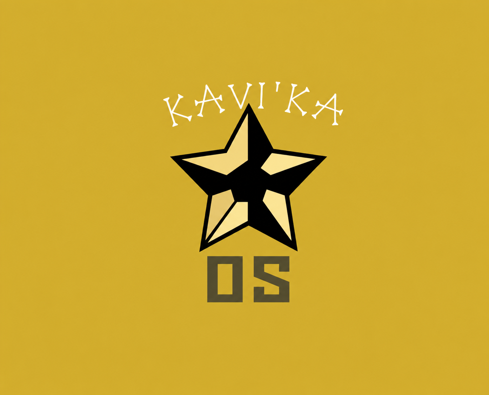

# Kavi'ka OS



A Linux-first desktop experience with a real Windows workspace one four-finger swipe away. The goal is to keep both environments available and make moving files between them straightforward.

The Windows side must be full, general-purpose Windows, including Comet and normal user-chosen app installation, not a restricted collection of supported apps. A test matrix measures compatibility; it must not become an app allowlist, and a VM limitation must be reported rather than silently redefined as out of scope. (The user's shorthand **"Comet" means the browser they use — Firefox** — not a specific third-party product; it opens in the feasibility guest.)

**Status: development checkpoint, not an installation release.** A Fedora-based diagnostic ISO and its source are implemented. The previous build reached a working KDE desktop in a disposable VM, and the Test Centre, hardware report, installer guard, SELinux and networking checks passed there. Its Meta+F12 workspace switch failed because of a line-ending defect; that is fixed, and a locally rebuilt image (SHA-256 `bd8407d6…`) has been booted both in a disposable KVM guest ([boot record](docs/validation/vm-boot-2026-10-20-laptop-studio.md)) and from USB on the Surface Laptop Studio, where the switch worked every time alongside pointer input, speakers, microphone, camera and Wi-Fi ([hardware boot record](docs/validation/hardware-boot-2026-10-20-laptop-studio.md)). The Surface Pro 8 (now dropped as a target) has never been booted with Kavi'ka. **The HP Envy x360 has now been booted live from USB, on 21 October 2026**, with Meta+F12 and Bluetooth both reported working ([record](docs/validation/hardware-boot-2026-10-21-envy.md)); it was not installed to. No ISO is approved for flashing. Cross-OS integration, a Windows guest inside the shipped image, a Surface-specific kernel and supported installation are not included; on the Windows side a **feasibility guest** completed a full Windows 11 installation, reached the desktop, **runs the user's browser (Firefox, recorded in the spec as "Comet")**, and is now **self-contained** — it boots with only its own disk attached, no external boot media (D21 closed). See the [Windows workspace notes](docs/windows-workspace.md) and the [Windows install recipe](docs/windows-install-recipe.md). The next milestone is the [HP Envy readiness gate](docs/envy-transfer.md). The newest image (`b5b650bc…`, 22 October 2026) presents itself as **Kavi'ka OS** in `os-release`, ships the Windows workspace plumbing and the installer assets (pre-flight + kickstart, not yet a bootable installer entry), and is boot-verified in a KVM guest ([record](docs/validation/vm-boot-2026-10-22-laptop-studio.md)). A separate **automated dnf/netinst installer** is now built and **KVM-verified end-to-end** (installs Kavi'ka OS with the virtualization stack, boots to first-boot) — see the [install record](docs/validation/vm-install-2026-10-22-laptop-studio.md).

See [the preview guide](docs/live-preview.md), [build instructions](docs/build.md), and [validation record](docs/validation/live-preview-0.1.0.md) before using an image. A desktop named “Windows (not installed)” is a Linux workspace, not a Windows implementation.

## Project documents

- [Features v2](features.md): revised product specification, preserving the original goal wording.
- [Implementation plan](implementation-plan.md): architecture, dependencies, milestones, and release gates.
- [OS implementation plan](os-implementation-plan.md): roadmap from the validated integration prototype to a live ISO, installer, and maintained OS release.
- [Windows preview VM guide](docs/windows-vm-preview.md): disposable Linux smoke-test guest, not the full Windows product workspace.
- [Windows install recipe](docs/windows-install-recipe.md): the verified way to install Windows 11 in a KVM guest here, and why each non-obvious step exists.
- [Reusing the existing Windows](docs/windows-reuse-existing-install.md): whether the Windows workspace can be the Windows already on the machine, the three routes, and their real costs (BitLocker/TPM, activation, no GPU acceleration).
- [Windows workspace](docs/windows-workspace.md): how Windows is presented as a swipeable workspace, and what is verified versus still assumed.
- [Get a diagnostic ISO](docs/getting-the-iso.md): prepare an isolated Ubuntu-on-WSL builder, verify Fedora input and build the explicitly non-installable preview.
- [Build instructions](docs/build.md): pinned source, builder prerequisites, and validation limits.

- [Target machines](docs/target-machines.md): the HP Envy install target, the Laptop Studio test machine, the dropped Surface Pro 8, permissions and the test route.
- [Envy transfer and readiness](docs/envy-transfer.md): what carries over to the HP Envy, what does not, and the gate before its Windows is replaced.
- [Surface Laptop Studio test machine](docs/surface-laptop-studio-test-machine.md): the Fedora machine used for KVM and VM testing, how it differs from the Pro 8, and the safe test steps.
- [Archive review](docs/review-upload.md): changes reviewed, documentation corrections, and verification limits.
- [Bug tracker](bugtracker.md): confirmed-defect policy, untested risks, and verification checklist.
- [Handoff](handoff.md): paused checkpoint, exact validation boundary, permissions and resume instructions.
- [Test install on the HP Envy](testinstall.md): how to boot and evaluate the preview on the install-target laptop without touching its Windows.
- [Installer build plan](installerinstallation.md): the phased roadmap for turning the preview into a safe, consent-driven installer (OS4) — decisions, kickstart, pre-flight, validation ladder.
- [Original brief](docs/original-features.md): supplied text, with Markdown heading syntax repaired only.
- [GitHub Issues](https://github.com/kaavi-pixel/kavika-os/issues): live task and risk tracking.

## Linux distribution

The proposed Linux base is **Fedora KDE Plasma Desktop**, using KDE Plasma on Wayland. Fedora is the distribution; KDE Plasma is the desktop environment.

- **Linux host:** Fedora KDE Plasma Desktop for native Linux applications and workspace switching.
- **Windows workspace:** a full Windows 11 installation in a QEMU/KVM virtual machine managed by libvirt, including Comet and normal user-chosen applications.
- **Preview base:** Fedora KDE 44, upstream image `44-1.7.x86_64`, stock kernel `6.19.10-300.fc44.x86_64`. This pins the diagnostic build, not a hardware-approved production configuration.

This is the initial implementation target, not a claim that the laptop or every Windows workload has already been validated. If testing exposes an important compatibility limitation, revisit the architecture rather than silently reducing the full-Windows requirement.

### Why Fedora KDE?

- **Desktop integration:** KDE provides virtual desktops and window rules for assigning applications to a particular desktop, useful building blocks for the proposed dedicated Windows workspace ([KDE window behaviour](https://docs.kde.org/stable_kf6/en/kwin/kcontrol/windowbehaviour/index.html)).
- **Virtualisation tooling:** Fedora documents a QEMU/KVM and libvirt workflow with tools such as virt-manager and virt-viewer, matching the proposed guest architecture ([Fedora virtualisation guide](https://docs.fedoraproject.org/en-US/quick-docs/virtualization-getting-started/)).
- **Customisation and current software:** Fedora KDE emphasises a customisable desktop and updated drivers and kernels; these make it a reasonable candidate for the project's integration work, not proof of compatibility with this laptop ([Fedora KDE](https://fedoraproject.org/kde/)).

The trade-off is ongoing maintenance: Fedora documents approximately 13 months of updates per release, so the project must plan regular upgrades and regression tests ([Fedora KDE](https://fedoraproject.org/kde/)). Four-finger switching with a full-screen Windows viewer, memory headroom, and full-Windows application workflows still need hardware validation; choosing Fedora does not establish those results.

## Proposed experience

```text
Laptop
└── Fedora KDE Plasma Desktop (Wayland)
    ├── Linux workspace: native applications
    └── Windows workspace: full-screen VM viewer
        └── Windows 11 in QEMU/KVM, managed by libvirt

Linux <── dedicated, permission-limited shared folder ──> Windows
```

Four-finger horizontal swipes should move between the two workspaces. A configurable host-owned keyboard shortcut should remain available as an alternative and emergency exit.

Wine is optional for individual applications; it is not the Windows workspace. Wine implements Windows application interfaces rather than running an installed Windows OS ([Wine](https://www.winehq.org/about)).

## Project logo

The user-selected project logo is stored at [`assets/branding/kavi-ka-os-logo.png`](assets/branding/kavi-ka-os-logo.png). The supplied image is preserved unchanged; the README only sets its display width.

## Targets: HP Envy (final), Surface Laptop Studio (test), Surface Pro 8 (dropped)

| Machine | Role |
|---|---|
| **HP Envy x360 (Ryzen 7 8840HS, 16 GB, 1 TB)** — **the only install target** (20 October 2026). Windows replacement there is the end state, gated on the Laptop Studio passing and a fresh explicit go-ahead. Runs Windows today and is the project's build helper; its internal disk is not in any erase approval. **Booted live from USB on 21 October 2026** (first Envy boot; Meta+F12 and Bluetooth reported working). | **Install target** |
| **Surface Laptop Studio** (Core i5-11300H, 16 GiB, 256 GB NVMe, Iris Xe) | Test machine that already runs Fedora 44. Preflight passed, KVM guest boot passed, and a **physical USB boot passed on 20 October 2026** with Meta+F12 working repeatedly; see [the Laptop Studio page](docs/surface-laptop-studio-test-machine.md). |
| **Surface Pro 8 Wi-Fi (model 1983)** — **dropped** as a target on 20 October 2026; its earlier approvals are withdrawn rather than transferred. | Not a target |

The **Laptop Studio and Surface Pro 8 are both Intel Tiger Lake**, so KVM, the Iris Xe driver and the stock kernel behave similarly on them; the Laptop Studio is still **not** a proxy for the Pro 8's Type Cover, touch, pen, tablet mode, cameras or storage budget. The **HP Envy is AMD (Ryzen 7 8840HS, Radeon 780M, AMD-V)**, so nothing platform-specific measured on the Surfaces transfers to the final target. Treat results on any machine as evidence, never proof for another.

On the Laptop Studio the physical boot confirmed pointer input, speakers, microphone, camera, Wi-Fi, battery reporting and thermals, and the workspace switch worked every time. The **touchscreen does not work on the stock kernel**, matching the preflight finding that no touch/pen input device is exposed, and no pen was available to test.

The **Surface Pro 8 is dropped as a target**, so its earlier plans are withdrawn rather than pending. Its record is retained for reference: model 1983 Wi-Fi, owner-reported **128 GB** factory marking, Windows 11, and CPU/RAM/SSD never measured.

The linux-surface compatibility matrix lists touchscreen and pen on both Surfaces, and the Pro 8's Type Cover keyboard and touchpad, as needing its custom kernel ([linux-surface device matrix](https://github.com/linux-surface/linux-surface/wiki/Supported-Devices-and-Features)). The preview uses Fedora's stock kernel, hence the touchscreen result above. Sleep and Secure Boot remain unvalidated on every machine, and no firmware-security changes are authorised.

See [the target machines record](docs/target-machines.md) and [the Laptop Studio page](docs/surface-laptop-studio-test-machine.md).

## Scope and safety

- **In scope:** repository development toward a reversible prototype and, after validation, an installable Fedora-based OS. Build, installation, and release work have separate gates in the OS implementation plan.
- **Target change, 20 October 2026:** the user stated the finished OS should end up on the **HP Envy x360 (1 TB)**, with the Laptop Studio as the test machine. The earlier approval covered the Surface Pro 8's internal disk and the empty 512 GB external SSD; **it does not transfer to the Envy.** No internal disk on any machine has been written.
- **Outside the recorded approval:** any internal-disk change to the HP Envy or the Laptop Studio, other drives, firmware-security changes, Windows licence purchases, and a public ISO release. Guest provisioning remains a separate opt-in step.
- **Not included:** Windows installation media, activation keys, VM disks, recovery keys, device identifiers, or the original hardware screenshot.
- **Licensing:** no project-wide open-source licence has been selected. Third-party components retain their own licences; a Windows licence decision remains a setup gate.
- **Rejected scope, 22 October 2026:** a three-world layout adding a macOS guest was considered and **dropped**. macOS cannot legally run on non-Apple hardware (Apple's EULA) and could never be redistributed in a Kavi'ka image; on the AMD HP Envy (Ryzen 7 8840HS, Radeon 780M) it would also have no GPU support and run software-rendered. The product stays **two-world: Linux host + Windows guest**. Do not re-open without the user explicitly asking.

The user has requested a testable OS for the spare Surface. An explicitly labelled private boot/diagnostic preview may be built before all integration gates pass, but the full installer/release gates remain; booting a preview is not proof of full Windows functionality.

On 16 October the user requested a stop at a good checkpoint and a GitHub update after being informed that the existing repository is public. Source and documentation are updated in that repository without changing visibility; the ISO is not published or released.

The preview is composed from an integrity-verified Fedora KDE 44 x86_64 image plus a project-owned live-session overlay. The original Fedora kernel and base filesystem remain unchanged; this is not a custom Surface-kernel build or a completed Linux/Windows OS.

## Preliminary Windows checks

[`tools/Test-KavikaHost.ps1`](tools/Test-KavikaHost.ps1) queries Windows CIM information and prints a JSON report. Static review found no explicit configuration-changing commands; it was not executed during this review, and its existence is not a compatibility pass.

Run it only on the intended Windows test machine after reviewing the script:

```powershell
.\tools\Test-KavikaHost.ps1
```

Do not disable execution-policy or security controls just to run a downloaded script. Review the output before recording selected results in the M0 worksheet; Windows checks do not establish Linux touchpad, KVM, graphics, or sleep support.
